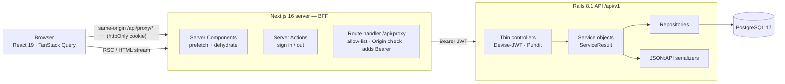
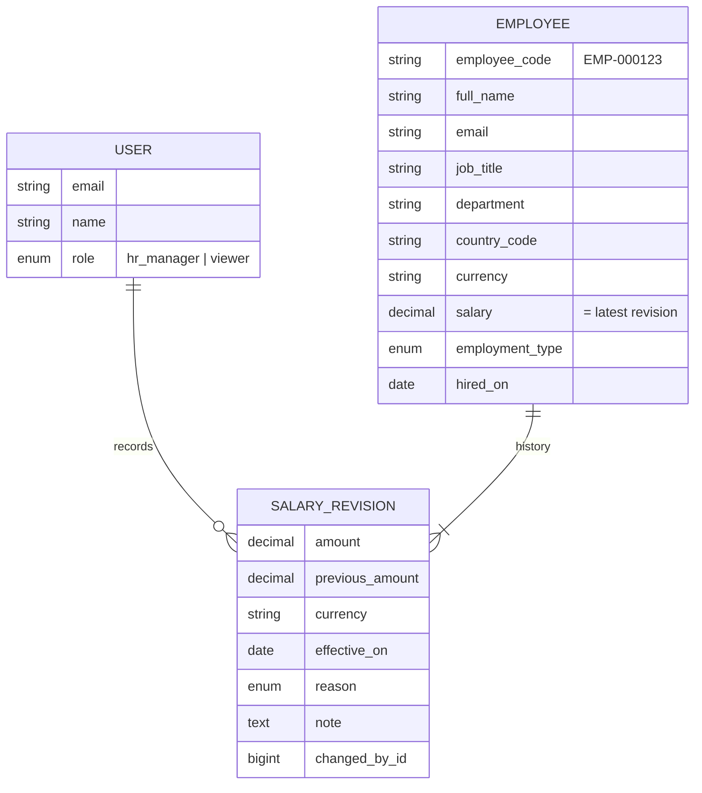

# ACME Salary Management

Web app for ACME's HR team to manage salaries for **10,000 employees across 10 countries** — replacing
spreadsheets — and to answer *"how does the org pay people?"* in seconds.

**Rails 8.1 API** (Devise-JWT, Pundit, rswag) · **Next.js 16** (App Router, PPR, TanStack Query, shadcn/ui) ·
**PostgreSQL 17** · one monorepo · `docker compose up` with live reload.

---

## Quick start

```bash
docker compose up --build        # first run ~5 min (gems + npm); later boots ~15 s
```

| What | URL |
|---|---|
| App (Next.js) | http://localhost:3000 |
| API (Rails) | http://localhost:3001 |
| Swagger UI | http://localhost:3001/api-docs |

The first boot creates the database and seeds **10,000 employees with ~23k salary revisions** (≈ 5 s).
Code is bind-mounted: edit files on the host and the running Rails / Next servers pick the change up.

| Sign in as | Password | Role |
|---|---|---|
| `hr@acme.test` | `Password@123` | **HR Manager** — full read/write |
| `viewer@acme.test` | `Password@123` | **Viewer** — read-only |

<details>
<summary>Without Docker</summary>

Requires Ruby 4.0.7, Node 22, PostgreSQL 17.

```bash
cd backend && bundle install && bin/rails db:prepare db:seed && bin/rails s -p 3001
cd frontend && npm ci && API_URL=http://localhost:3001 npm run dev
```
</details>

---

## The problem and the product

**Persona:** ACME's HR Manager (plus read-only viewers such as finance/leadership).
**Today:** one spreadsheet per country, overwritten cells, no history, currency mixing in every pivot.

| Job to be done | How the app does it |
|---|---|
| Find someone and see what they earn | Server-side search (name / email / code), filters (country, department, job title, type), sort, pagination |
| Keep records correct | Validated create/edit forms; server-side rules; role-gated writes |
| Give a raise without losing history | **Append-only salary revisions** — amount, effective date, reason, note, who recorded it, % change |
| "What do we pay engineers in India vs Germany?" | **Insights** by country, job title, department, salary distribution, recent raises — local currency per country, USD org-wide |
| Hand data to someone | CSV export of the current filtered view (HR Manager only, formula-injection safe) |

### Deliberately left out (and why)
| Not built | Why |
|---|---|
| Excel/CSV **import** | The real migration path — but a safe importer needs dry-run, row-level errors and de-duplication. First v2 item; the seed proves the bulk-insert path. |
| Payroll, tax, net pay | A different product (country tax engines, compliance). The brief is *managing* and *understanding* pay. |
| Bonus / equity / bands | Base salary answers the core questions; total comp needs product decisions we don't have. |
| Live FX rates | Static, dated rates keep reports reproducible and tests deterministic; the as-of date is shown in the UI. |
| Gender pay-equity analysis | Sensitive personal data — needs legal review and consent before it's collected. |
| Approvals, self-service, SSO, user admin | Persona is HR only; one org, a handful of seeded HR users. |
| Soft delete, future-dated raises, relocations | Retention policy, scheduled activation and re-pricing in a new currency are product/compliance decisions to make with HR. |

---

## Architecture



**Why a BFF?** The JWT lives in an `httpOnly` cookie on the Next.js origin and never reaches browser
JavaScript, so an XSS bug can't steal a session. Server Components call Rails directly; client components go
through a same-origin proxy that attaches the token. Rails stays a clean, stateless JSON API (also usable from
Swagger with a Bearer token).

### Repository layout
```
backend/     Rails API — controllers/api/v1 → services/<domain>_service → services/repositories → serializers/v1, policies/
frontend/    Next.js — app/ (routes) · features/<domain>/{api,queries,mutations,params,schemas,sections,containers}
             components/{ui,atoms,molecules,organisms,templates} (Atomic Design) · lib/{api,auth,…}
.claude/     AI agent briefs and skills used to build this repo (see "How AI was used")
.github/     CI: backend (RSpec, RuboCop, Brakeman) + frontend (lint, typecheck, Vitest, build)
docker-compose.yml   db + backend + frontend, bind mounts for live reload
```
Each app has its own README with deeper detail: [`backend/README.md`](backend/README.md), [`frontend/README.md`](frontend/README.md).

### Domain model


**Rules** (each covered by specs):
1. An employee is paid in their **country's currency** — derived, never typed in.
2. `employees.salary` is a **denormalised copy of the latest revision**, written only by the two services that
   create revisions, inside a transaction with a row lock — so lists sort and aggregate without subqueries.
3. Revisions are **append-only**; mistakes are fixed with a new `correction` revision.
4. Creating an employee records the `hire` revision; correcting `hired_on` moves it (never past the first raise).
5. A revision's effective date is ≤ today (UTC), ≥ hire date, ≥ the latest revision.
6. `country_code` can't change after creation (relocation = re-pricing in another currency → v2).
7. Org-wide numbers are normalised to **USD** with a dated FX table; per-country numbers stay in local currency.
8. Text input is normalised (`strip_tags` + `squish`) before validation — defence in depth against stored XSS.

---

## Roles

| Capability | HR Manager | Viewer |
|---|:-:|:-:|
| Dashboard, insights, employee list, employee profile, salary history | ✅ | ✅ |
| Add / edit / delete employee | ✅ | ❌ (403 page; API returns 403) |
| Record salary change | ✅ | ❌ |
| Export CSV | ✅ | ❌ |

Pundit enforces every action on the server (`verify_authorized` makes a forgotten check fail loudly);
the UI uses one `can(role, action)` helper only to hide affordances.

## API (v1)

Full, example-rich OpenAPI docs at **`/api-docs`** (generated from the request specs, so they can't drift).

| Method & path | Purpose | Roles |
|---|---|---|
| `POST /auth/sign_in` · `DELETE /auth/sign_out` · `GET /me` | JWT sign in (token in `Authorization` header), revoke, current user | all |
| `GET /lookups` | Countries + currencies, departments, job titles, employment types, revision reasons, FX table | all |
| `GET /employees` | Search `q`, filter `country/department/job_title/employment_type`, `sort/direction`, `page/per_page` (≤ 100) | all |
| `GET /employees/:id` | Employee incl. salary in local currency and USD | all |
| `POST /employees` · `PATCH /employees/:id` · `DELETE /employees/:id` | Create (records `hire` revision) / edit profile (not salary) / delete | HR Manager |
| `GET /employees/export` | CSV of the filtered list | HR Manager |
| `GET /employees/:id/salary_revisions` | History, newest first, with % change and author | all |
| `POST /employees/:id/salary_revisions` | Record a change; updates current salary atomically | HR Manager |
| `GET /insights/overview` | Headcount, countries, payroll, average and median (USD) | all |
| `GET /insights/by_country` | Min / median / avg / max per country (local + USD), payroll | all |
| `GET /insights/by_job_title?country=` · `/by_department?country=` | Pay by title / department, local currency or USD org-wide | all |
| `GET /insights/salary_distribution?country=` | 10-bucket histogram | all |
| `GET /insights/recent_changes?days=90` | Raises in the window, average % by reason | all |

Envelope: `{ success, message, data, meta }` / `{ success: false, errors: { field: [...] } }`;
statuses 400 / 401 / 403 / 404 / 422 / 429.

---

## Engineering notes

### Performance (10k employees)
- Server-side pagination; never ships 10k rows to the browser.
- Indexes for the real query patterns: unique email/code, `(country_code, job_title)`, department, salary,
  hired_on, **GIN trigram** on name/email for `ILIKE` search, `(employee_id, effective_on)` on revisions.
- Insights are single-table aggregates (`percentile_cont` for medians) **cached by a data version**
  (`count`, `max(updated_at)`, `max(revision id)`) — any write invalidates automatically, no busting code.
- Seed uses `insert_all` in batches: 10k employees + history in ~5 s, deterministic (fixed RNG seed).
- Bullet fails the test suite on N+1 queries.
- Frontend: Server Components prefetch and hydrate the query cache (no client waterfall), **Partial
  Prerendering** (static shell instantly, data streamed in `<Suspense>`), `keepPreviousData` paging,
  debounced search, URL as state, charts code-split with `next/dynamic`.

### Security
| Threat | Mitigation |
|---|---|
| Session theft via XSS | JWT only in an `httpOnly`, `SameSite=Lax`, `Secure` (prod) cookie; never in client JS |
| XSS | React escaping, ESLint bans `dangerouslySetInnerHTML`, server-side `strip_tags`, CSP + security headers, HSTS |
| CSRF | SameSite cookie + Origin check on non-GET proxy calls; server actions are Origin-checked by Next |
| Brute force | Devise `lockable` (5 attempts / 15 min) + Rails 8 `rate_limit` keyed by IP + email |
| Broken access control | Pundit on every action + request specs per role; write pages gated server-side |
| Token replay | 8 h expiry + JTI denylist on sign-out |
| Injection | Allow-listed sort columns, bound params, escaped `LIKE`, proxy path allow-list (no SSRF/traversal) |
| CSV formula injection | Cells starting `= + - @ \t \r` are prefixed with `'` |
| Mass assignment | `params.expect` per action; salary only changes through revisions |
| Secrets | ENV only; `filter_parameters` covers password/token/salary; production seeding requires `SEED_PASSWORD` |

Known trade-off: CSP allows `'unsafe-inline'` scripts because nonce-based CSP would make every page fully
dynamic and defeat PPR's static shells. The mitigations above don't depend on CSP.

### Key trade-offs
| Decision | Alternative | Why |
|---|---|---|
| PostgreSQL | SQLite (suggested) | Medians via `percentile_cont`, trigram search, check constraints, sequences; same engine everywhere |
| Denormalised current salary | Derive latest revision per query | Single-table sorts/aggregates at 10k rows; consistency guarded by one write path + row lock |
| BFF with httpOnly cookie | Token in `localStorage` | XSS can't exfiltrate the session; no CORS for the app |
| Static FX table | Live FX API | Reproducible reports, deterministic tests |
| Data-version cache keys | Manual invalidation / materialised views | Nothing to forget; MV is overkill at this size |
| Services + repositories (house style) | Fat models | One class per use case; queries in one place; easy to test in isolation |

### Tests
| Suite | What | Run |
|---|---|---|
| Backend — RSpec | Models, services (every domain rule), Pundit policies, rswag request specs per role (2xx/401/403/404/422), insights math, caching, seeds — **221 examples, ~99.9 % line coverage, ~6 s** | `cd backend && bundle exec rspec` |
| Frontend — Vitest | Utilities, zod schemas, URL params, permissions, proxy handler (allow-list, Origin, size limit), organisms per role, forms, mutations' cache invalidation | `cd frontend && npm test` |

Also: `bundle exec rubocop`, `bundle exec brakeman`, `npm run lint`, `npm run typecheck`, `npm run build` — all in CI.

---

## How AI was used

Built with **Claude Code** acting as an orchestrator over sub-agents, with me owning the decisions.

1. **Framing first, by hand + AI:** requirements, domain rules, architecture and a precise API contract were
   written *before any code*; they became the context for every agent.
2. **Contract-first parallel build:** a backend agent and a frontend agent worked simultaneously in separate
   git worktrees against the same contract, each with an explicit Definition of Done (tests, lint, build,
   manual smoke). Their role briefs are committed in [`.claude/agents/`](.claude/agents).
3. **Verify, don't trust:** I re-ran every gate on merge and drove the real stack in a headless browser —
   which caught two bugs the unit tests didn't (a hydration race that corrupted edited text, and a refetch
   of a deleted record). Both fixed with regression tests.
4. **Independent review agents:** a security reviewer and a code-quality reviewer (fresh context, code only)
   found a sign-in rate-limit DoS behind the BFF, a UTC-vs-local "today" mismatch, out-of-range pagination,
   an off-by-one window and more. Every finding was either fixed in its own commit with a test or kept as a
   documented trade-off.
5. **Reusable knowledge:** conventions are captured as skills ([`.claude/skills/`](.claude/skills)) —
   `rails-use-case` and `next-feature-module` — with references, verification scripts and evals, so the
   next feature (by a human or an agent) follows the same patterns. [`CLAUDE.md`](CLAUDE.md) is the working agreement.
6. **Guardrails as code:** `verify_authorized`, ESLint `react/no-danger`, Bullet, CI.

The commit history shows the evolution: scaffold → auth → domain → APIs → seed → UI → integration fixes →
Docker/CI → review fixes.

## Deploying

Both apps ship production Dockerfiles (`backend/Dockerfile` from Rails, `frontend/Dockerfile` multi-stage
standalone, non-root). Any container host works (Render, Fly.io, Railway, ECS):

| Service | Required env |
|---|---|
| Postgres 17 | — |
| backend | `DATABASE_URL`, `SECRET_KEY_BASE`, `DEVISE_JWT_SECRET_KEY`, `FRONTEND_ORIGIN`, `SEED_PASSWORD` (for `db:seed`) |
| frontend | `API_URL` (internal URL of the backend) |

Run `bin/rails db:prepare db:seed` once on the backend, then point users at the frontend.
